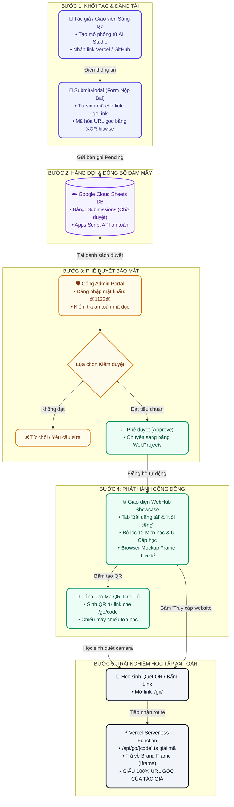
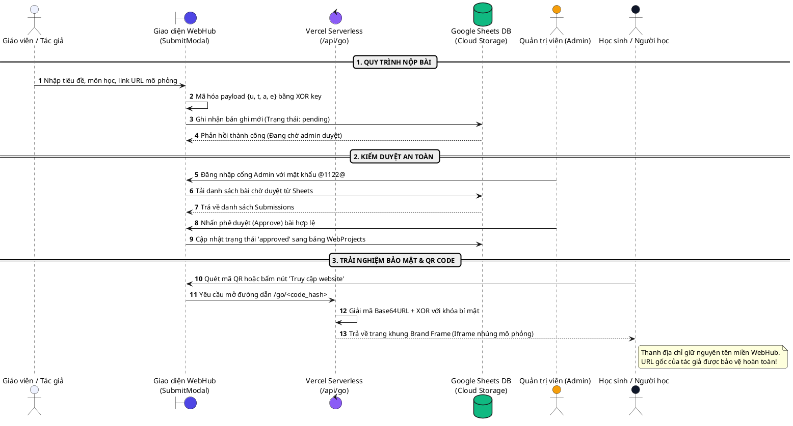
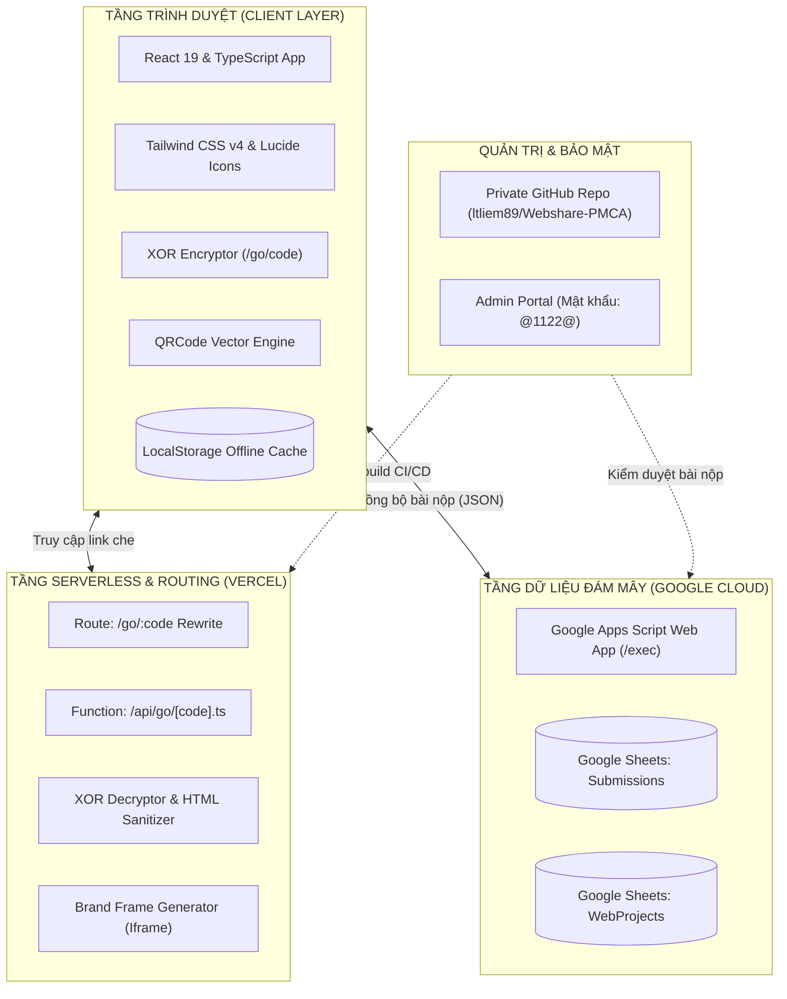
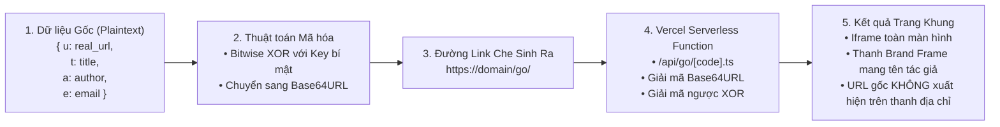
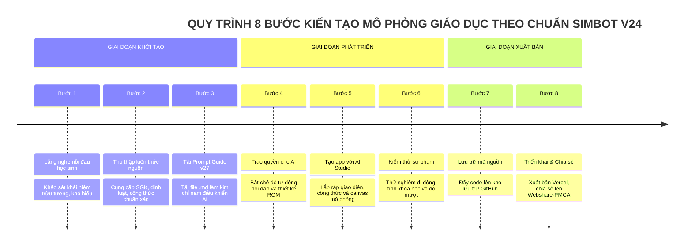

# BỘ LỆNH & MÃ NGUỒN XUẤT HÌNH ẢNH / SƠ ĐỒ CHUYÊN NGHIỆP
## DỰ ÁN WEBSHARE-PMCA (WEBHUB SHOWCASE)
*Tài liệu chuẩn dành cho các công cụ AI Tạo ảnh (Midjourney, DALL-E 3, Stable Diffusion), AI Thiết kế (ChatGPT, Claude, Gemini, Figma AI) và các Engine vẽ sơ đồ (Mermaid, PlantUML, Graphviz, Python SVG)*

---

## MỤC LỤC
1. [Bảng Màu Nhận Diện & Chuẩn Thiết Kế (Design System)](#1-bảng-màu-nhận-diện--chuẩn-thiết-kế-design-system)
2. [SƠ ĐỒ 1: Sơ Đồ Luồng Hoạt Động Tổng Thể (Overall Workflow)](#2-sơ-đồ-1-sơ-đồ-luồng-hoạt-động-tổng-thể-overall-workflow)
3. [SƠ ĐỒ 2: Sơ Đồ Kiến Trúc Hệ Thống Đa Tầng (Multi-tier Architecture)](#3-sơ-đồ-2-sơ-đồ-kiến-trúc-hệ-thống-đa-tầng-multi-tier-architecture)
4. [SƠ ĐỒ 3: Cơ Chế Link Che & Bảo Vệ URL Gốc (/go/<code> Security Flow)](#4-sơ-đồ-3-cơ-chế-link-che--bảo-vệ-url-gốc-go-security-flow)
5. [SƠ ĐỒ 4: Chu trình 8 Bước SimBot Universal Prompt Guide v27](#5-sơ-đồ-4-chu-trình-8-bước-simbot-universal-prompt-guide-v24)
6. [Mã SVG Hoàn Chỉnh Cho Sơ Đồ Luồng Hoạt Động (Copy Dùng Ngay)](#6-mã-svg-hoàn-chỉnh-cho-sơ-đồ-luồng-hoạt-động-copy-dùng-ngay)
7. [Script Python Tự Động Xuất Ảnh Độ Nét Cao (600 DPI)](#7-script-python-tự-động-xuất-ảnh-độ-nét-cao-600-dpi)

---

## 1. BẢNG MÀU NHẬN DIỆN & CHUẨN THIẾT KẾ (DESIGN SYSTEM)

Khi cung cấp lệnh cho các AI vẽ đồ họa, hãy giữ nguyên các mã màu và kiểu dáng dưới đây để hình ảnh đồng bộ với website:

| Thành phần | Mã Hex | Tên màu Tailwind | Mục đích sử dụng |
| :--- | :--- | :--- | :--- |
| **Màu chủ đạo (Primary)** | `#4F46E5` / `#6366F1` | `indigo-600` / `indigo-500` | Thương hiệu, Header, Logo, Nút bấm hành động chính |
| **Màu thứ cấp (Secondary)** | `#7C3AED` / `#8B5CF6` | `violet-600` / `violet-500` | Gradient nhận diện, Icon AI, Cẩm nang SimBot |
| **Màu thành công (Success)** | `#059669` / `#10B981` | `emerald-600` / `emerald-500` | Đã duyệt (Approved), Trạng thái bảo mật SSL, Tải file |
| **Màu cảnh báo / Admin** | `#D97706` / `#F59E0B` | `amber-600` / `amber-500` | Tab Nổi tiếng, Cổng Admin (@1122@), Chờ duyệt (Pending) |
| **Màu nền tối (Dark Slate)** | `#0F172A` / `#1E293B` | `slate-900` / `slate-800` | Thanh Hero Banner, Khung Brand Frame (/go/), Chân trang |
| **Màu nền sáng (Light BG)** | `#F8FAFC` / `#FFFFFF` | `slate-50` / `white` | Nền trang web, thẻ bài mô phỏng, nền sơ đồ |
| **Font chữ đề xuất** | `Plus Jakarta Sans`, `Inter`, `Space Grotesk` | Phong cách hiện đại, thanh thoát, khoa học |

---

## 2. SƠ ĐỒ 1: SƠ ĐỒ LUỒNG HOẠT ĐỘNG TỔNG THỂ (OVERALL WORKFLOW)
*(Sơ đồ trọng tâm nhất của hệ thống: từ lúc người tạo nộp bài cho đến khi học sinh mở mô phỏng)*

### 2.1. Prompt Dành Cho AI Tạo Ảnh Nghệ Thuật (Midjourney v6 / DALL-E 3 / Ideogram)
> **Lưu ý cách dùng:** Sao chép đoạn prompt tiếng Anh bên dưới và dán vào Discord (Midjourney), ChatGPT Plus (DALL-E 3) hoặc Ideogram.ai để tạo ảnh infographic 3D/Isometric cực đẹp.

```text
Professional tech infographic flowchart illustrating the end-to-end operational workflow of Webshare-PMCA educational simulation platform. 
The visual flow has 5 clearly organized, sequential modern cards on a clean light slate grey background (#F8FAFC):
Step 1: "Teacher / Creator Submits Simulation" (icon of educator submitting web project, URL input form).
Step 2: "Security Encryption & Pending Queue" (icon of encryption lock, data moving securely to Google Cloud Sheets database).
Step 3: "Admin Portal Moderation" (icon of admin dashboard with shield, passcode authentication '@1122@', approve/reject buttons).
Step 4: "Public Showcase & Instant QR Code" (icon of web card mockup with QR code generator, subject tags, STEM simulation badges).
Step 5: "Student Experience via Protected Frame" (students scanning QR with smartphone or tablet, entering /go/code iframe browser frame with masked URL, author badge, fullscreen toggle).
Design Style: Modern SaaS corporate vector illustration, clean lines, vibrant indigo (#4F46E5) and emerald (#10B981) accents, glossy rounded cards with subtle drop shadows, isometric perspective, elegant data connector arrows, high resolution, 8k, UI/UX diagram aesthetic, sharp typography, no spelling errors --ar 16:9 --style raw --v 6.0
```

---

### 2.2. Mã Nguồn Mermaid.js (Dành cho Mermaid Live Editor / GitHub / Notion / Obsidian)
> **Cách dùng:** Truy cập [mermaid.live](https://mermaid.live), dán đoạn mã bên dưới để xem hoặc tải ảnh PNG/SVG vector tức thì.



---

### 2.3. Mã Nguồn PlantUML Sequence (Sơ đồ Tuần tự Chi tiết)
> **Cách dùng:** Dán vào [planttext.com](https://www.planttext.com) để xuất ảnh kỹ thuật chuẩn IEEE.



---

## 3. SƠ ĐỒ 2: SƠ ĐỒ KIẾN TRÚC HỆ THỐNG ĐA TẦNG (MULTI-TIER ARCHITECTURE)

### 3.1. Prompt Cho AI Tạo Ảnh (Midjourney / DALL-E 3)
```text
Clean 3-tier software architecture isometric diagram for Webshare-PMCA web application.
Top Tier: "Client Browser Layer" featuring React 19, TypeScript, Tailwind CSS v4, Lucide Icons, Client-side QR generator, and offline LocalStorage cache.
Middle Tier: "Serverless Compute & Security Proxy" with Vercel Serverless Node.js runtime, /api/go/[code].ts endpoint decoding encrypted parameters and rendering an isolated Brand Frame.
Bottom Tier: "Cloud Headless Database" featuring Google Cloud Sheets synchronized via Google Apps Script Web App endpoints for submissions and approval sync.
Side Panel: "Security & Source Code Protection" showing Private GitHub repository CI/CD pipeline, and Admin Portal authenticated with passcode @1122@.
Color Theme: Dark blue and white high-tech palette, soft cyan neon outlines, clean isometric floating glass layers, clear technical typography, ultra-high resolution 8K --ar 16:9
```

### 3.2. Mã Nguồn Mermaid.js


---

## 4. SƠ ĐỒ 3: CƠ CHẾ LINK CHE & BẢO VỆ URL GỐC (/go/<code> SECURITY FLOW)

### 4.1. Prompt Cho AI Tạo Ảnh
```text
Detailed cybersecurity and cryptographic pipeline infographic explaining the URL masking mechanism of Webshare-PMCA.
Left: Plaintext JSON payload containing {url, title, author, email}.
Middle: Encryption step using Bitwise XOR cipher with secret key 'webhub-go-v2#sbx7q' converting to Base64URL string.
Right: Decryption in Vercel Serverless Function returning an encapsulated Brand Frame webpage with custom author header and embedded sandbox iframe.
Bottom highlighted callout: "Original URL is completely hidden from the browser address bar and DOM elements".
Style: Cybersecurity tech diagram, dark mode aesthetic, glowing emerald and indigo data packets, clean cyber locks, 8K resolution --ar 16:9
```

### 4.2. Mã Nguồn Mermaid.js


---

## 5. SƠ ĐỒ 4: CHU TRÌNH 8 BƯỚC SIMBOT UNIVERSAL PROMPT GUIDE V24

### 5.1. Prompt Cho AI Tạo Ảnh
```text
Educational infographic showcasing an 8-step circular or linear progression for building AI simulations named 'SimBot Universal Prompt Guide v27'.
Step 1: Listen to Student Needs.
Step 2: Collect Source Knowledge.
Step 3: Download Prompt Guide v27 (.md).
Step 4: Empower AI with System Prompt.
Step 5: Create App with Google AI Studio.
Step 6: Pedagogical & Mobile Testing.
Step 7: Store Code in GitHub Repository.
Step 8: Deploy on Vercel & Share to Webshare-PMCA.
Style: Clean modern educational timeline, vibrant pastel badges (Indigo, Emerald, Violet, Amber, Sky), numbered icons, elegant arrows, professional white background, vector graphic style --ar 16:9
```

### 5.2. Mã Nguồn Mermaid.js


---

## 6. MÃ SVG HOÀN CHỈNH CHO SƠ ĐỒ LUỒNG HOẠT ĐỘNG (COPY DÙNG NGAY)
> **Cách dùng:** Bạn có thể lưu đoạn mã XML dưới đây thành tệp `EduCam/so_do_luong_hoat_dong.svg`. Tệp SVG là định dạng vector thuần, có thể phóng to vô hạn không vỡ nét, mở trực tiếp bằng trình duyệt, Word hoặc chèn vào slide PowerPoint.

```xml
<svg xmlns="http://www.w3.org/2000/svg" viewBox="0 0 1000 700" width="100%" height="100%" style="background:#f8fafc; font-family:'Plus Jakarta Sans', system-ui, sans-serif;">
  <defs>
    <filter id="shadow" x="-5%" y="-5%" width="110%" height="115%" filterUnits="userSpaceOnUse">
      <feDropShadow dx="0" dy="4" stdDeviation="6" flood-color="#0f172a" flood-opacity="0.08" />
    </filter>
    <linearGradient id="gradIndigo" x1="0%" y1="0%" x2="100%" y2="100%">
      <stop offset="0%" stop-color="#4f46e5" />
      <stop offset="100%" stop-color="#6366f1" />
    </linearGradient>
    <marker id="arrow" viewBox="0 0 10 10" refX="5" refY="5" markerWidth="6" markerHeight="6" orient="auto-start-reverse">
      <path d="M 0 1 L 10 5 L 0 9 z" fill="#4f46e5" />
    </marker>
  </defs>

  <!-- Tiêu đề sơ đồ -->
  <text x="500" y="45" text-anchor="middle" font-size="22" font-weight="800" fill="#0f172a">SƠ ĐỒ LUỒNG HOẠT ĐỘNG TỔNG THỂ WEBSHARE-PMCA</text>
  <text x="500" y="70" text-anchor="middle" font-size="13" font-weight="600" fill="#64748b">Quy trình nộp bài, kiểm duyệt, bảo vệ link che và trải nghiệm học sinh trong lớp học</text>

  <!-- Node 1: Tác giả nộp bài -->
  <g transform="translate(100, 100)" filter="url(#shadow)">
    <rect width="800" height="85" rx="16" fill="#ffffff" stroke="#4f46e5" stroke-width="2" />
    <rect width="8" height="85" rx="4" fill="#4f46e5" />
    <circle cx="45" cy="42" r="22" fill="#e0e7ff" />
    <text x="45" y="48" text-anchor="middle" font-size="20">👨‍🏫</text>
    <text x="85" y="36" font-size="16" font-weight="800" fill="#1e1b4b">BƯỚC 1: TÁC GIẢ ĐĂNG TẢI SẢN PHẨM (SubmitModal)</text>
    <text x="85" y="60" font-size="13" font-weight="500" fill="#475569">Người dùng điền link web, môn học, cấp học → Hệ thống tự sinh goLink &amp; mã hóa URL bằng XOR bitwise</text>
  </g>
  <line x1="500" y1="185" x2="500" y2="215" stroke="#4f46e5" stroke-width="3" marker-end="url(#arrow)" />

  <!-- Node 2: Hàng đợi xét duyệt -->
  <g transform="translate(100, 220)" filter="url(#shadow)">
    <rect width="800" height="85" rx="16" fill="#ffffff" stroke="#7c3aed" stroke-width="2" />
    <rect width="8" height="85" rx="4" fill="#7c3aed" />
    <circle cx="45" cy="42" r="22" fill="#ede9fe" />
    <text x="45" y="48" text-anchor="middle" font-size="20">☁️</text>
    <text x="85" y="36" font-size="16" font-weight="800" fill="#3b0764">BƯỚC 2: HÀNG ĐỢI XÉT DUYỆT (Google Cloud Sheets)</text>
    <text x="85" y="60" font-size="13" font-weight="500" fill="#475569">Đẩy bản ghi an toàn lên Google Sheets qua Apps Script Web App API (Lưu trạng thái Pending chờ duyệt)</text>
  </g>
  <line x1="500" y1="305" x2="500" y2="335" stroke="#7c3aed" stroke-width="3" marker-end="url(#arrow)" />

  <!-- Node 3: Admin kiểm duyệt -->
  <g transform="translate(100, 340)" filter="url(#shadow)">
    <rect width="800" height="85" rx="16" fill="#ffffff" stroke="#d97706" stroke-width="2" />
    <rect width="8" height="85" rx="4" fill="#d97706" />
    <circle cx="45" cy="42" r="22" fill="#fef3c7" />
    <text x="45" y="48" text-anchor="middle" font-size="20">🛡️</text>
    <text x="85" y="36" font-size="16" font-weight="800" fill="#78350f">BƯỚC 3: QUẢN TRỊ VIÊN KIỂM DUYỆT (Admin Portal @1122@)</text>
    <text x="85" y="60" font-size="13" font-weight="500" fill="#475569">Admin đăng nhập, kiểm tra an toàn mã độc, duyệt bài (Approved) chuyển sang bảng dữ liệu chính thức</text>
  </g>
  <line x1="500" y1="425" x2="500" y2="455" stroke="#d97706" stroke-width="3" marker-end="url(#arrow)" />

  <!-- Node 4: Xuất bản & QR Code -->
  <g transform="translate(100, 460)" filter="url(#shadow)">
    <rect width="800" height="85" rx="16" fill="#ffffff" stroke="#059669" stroke-width="2" />
    <rect width="8" height="85" rx="4" fill="#059669" />
    <circle cx="45" cy="42" r="22" fill="#ecfdf5" />
    <text x="45" y="48" text-anchor="middle" font-size="20">📱</text>
    <text x="85" y="36" font-size="16" font-weight="800" fill="#064e3b">BƯỚC 4: XUẤT BẢN CỘNG ĐỒNG &amp; MÃ QR TỨC THÌ</text>
    <text x="85" y="60" font-size="13" font-weight="500" fill="#475569">Hiển thị thẻ mô phỏng trên feed, phân loại 12 môn học, tạo mã QR tự động để chiếu lên máy chiếu lớp học</text>
  </g>
  <line x1="500" y1="545" x2="500" y2="575" stroke="#059669" stroke-width="3" marker-end="url(#arrow)" />

  <!-- Node 5: Trải nghiệm an toàn -->
  <g transform="translate(100, 580)" filter="url(#shadow)">
    <rect width="800" height="85" rx="16" fill="#ffffff" stroke="#0f172a" stroke-width="2" />
    <rect width="8" height="85" rx="4" fill="#0f172a" />
    <circle cx="45" cy="42" r="22" fill="#f1f5f9" />
    <text x="45" y="48" text-anchor="middle" font-size="20">🚀</text>
    <text x="85" y="36" font-size="16" font-weight="800" fill="#0f172a">BƯỚC 5: HỌC SINH TRẢI NGHIỆM AN TOÀN (/go/code Brand Frame)</text>
    <text x="85" y="60" font-size="13" font-weight="500" fill="#475569">Vercel giải mã Serverless, chạy iframe toàn màn hình, vinh danh tác giả và GIẤU KÍN 100% URL GỐC</text>
  </g>
</svg>
```

---

## 7. SCRIPT PYTHON TỰ ĐỘNG XUẤT ẢNH ĐỘ NÉT CAO (600 DPI)

Nếu bạn muốn tạo lại toàn bộ 3 sơ đồ dưới dạng hình ảnh cực nét (Ultra HD 600 DPI) để chèn vào báo cáo hoặc in ấn mà không sợ nhòe, bạn chỉ cần mở PowerShell và chạy lệnh:

```powershell
python -c "
import os, sys
sys.path.append('EduCam')
from build_thesis_docx import generate_diagrams
generate_diagrams()
print('Đã xuất thành công toàn bộ hình ảnh vào thư mục EduCam!')
"
```

---

## TỔNG KẾT HƯỚNG DẪN SỬ DỤNG
1. **Dùng với ChatGPT / Claude / Gemini:** Copy toàn bộ file này gửi cho AI và yêu cầu: *"Hãy căn cứ vào các prompt và mã sơ đồ trong tệp này để thiết kế lại sơ đồ theo phong cách hiện đại nhất"*.
2. **Dùng với công cụ Mermaid:** Mở [mermaid.live](https://mermaid.live), dán mã ở Mục 2.2 và bấm nút Export SVG.
3. **Dùng với tệp Word Luận văn:** File `.docx` tại [EduCam/TONG_QUAN_DU_AN_WEBSHARE_PMCA.docx](file:///c:/Users/ltlie/Documents/GIT-DA/Webshare-PMCA/EduCam/TONG_QUAN_DU_AN_WEBSHARE_PMCA.docx) đã được tích hợp sẵn 3 sơ đồ chất lượng cao này!
